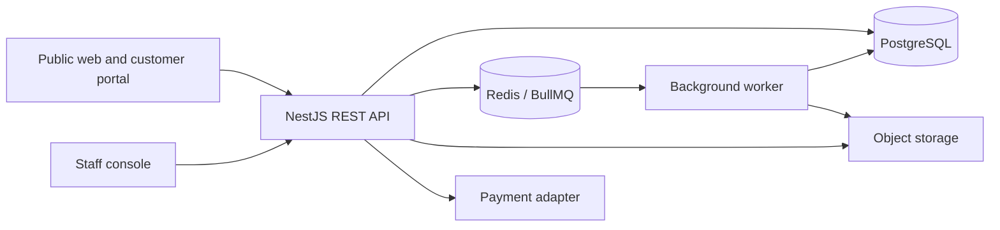

# Architecture

Source of truth is the [Software Architecture](../Docs.md/Marketplace_Software_Architecture.pdf). This file records its application to the workspace.

- Separate Next.js App Router frontends for public and staff users. Share UI tokens and generated OpenAPI types when those consumers exist. Keep server configuration outside browser bundles.
- The NestJS API exposes versioned REST under `/api/v1`. Identity, inventory/media, CRM, appointments, services, commerce, CMS, communications, analytics, and audit own their application logic. Use PostgreSQL transactions for cross-module invariants and queue work via Redis/BullMQ.
- Listings use a common aggregate with separate one-to-one category details. Start search with PostgreSQL indexes and typed filters. Expose approved fields only and protect private media with authorization and expiring signed access.
- Use explicit permission and ownership checks, secure staff authentication with MFA before production, CSRF protection for cookie mutations, and append-oriented audit events.
- Use exact money, currency, immutable order snapshots, verified provider events, unique idempotency keys, and transactional payment updates. Use persisted outbox events where receipt generation or notifications must survive partial failures.
- Deploy public web, admin, API, and worker independently when needed, backed by managed PostgreSQL, Redis, and private object storage. Validate release readiness in staging with synthetic data and sandbox providers.

## Phase 1 identity foundation

The API currently consists of Prisma, auth, users/staff, and health modules. Opaque cookie sessions reference database users. User-to-role and role-to-permission joins are loaded by the session guard. Staff access and resource ownership are checked on the server. See [identity and session decisions](DECISIONS/0003-identity-and-sessions.md) for deployment assumptions and production gates.

## Phase 2 inventory

Inventory owns listing lifecycle, category detail tables, location records, media ordering and inventory audit. The API and admin console share input validation and transition definitions through `@marketplace/inventory`. The API validates publication, requires per-operation permissions, and writes status, media metadata and audit records transactionally. See the [inventory and media ADR](DECISIONS/0004-inventory-and-media.md).

## Phase 3 public catalog

The public storefront reads versioned listing endpoints with an allowlisted response shape. The catalog applies publication and expiry checks to search, detail and media. SSR routes render the homepage, category pages, shareable filtered search and listing detail. See the [public catalog ADR](DECISIONS/0005-public-catalog.md) for visibility, demo data and pricing conventions.

## Phase 4 engagement

The engagement module owns customer profiles, saved inventory, enquiry and appointment records, and notifications. Staff flows enforce granular CRM and booking permissions. Customer-facing reads and mutations are scoped to the active session. Account verification and recovery create expiring single-use tokens and transactional mail jobs. See the [customer engagement ADR](DECISIONS/0006-customer-engagement.md).

## Phase 5 commerce

Orders snapshot listing and pricing data before payment. Payment attempts, provider events, receipts and refunds have distinct records and state transitions. Checkout, settlement and refunds use transactional locks and database uniqueness to preserve exact amounts and process retries safely. The provider adapter, customer history and staff reconciliation are documented in the [commerce ADR](DECISIONS/0007-commerce-sandbox.md).

## Phase 6 professional services

The services module manages customer requests, staff triage, request messages, quotation revisions and project milestones. Quote acceptance creates an order with immutable line snapshots. Payment, receipts and refunds use the commerce engine. See the [service quotations ADR](DECISIONS/0008-service-quotations.md).

## Phase 7 editorial and reporting

The editorial module keeps drafts separate from public snapshots and records publication and export actions. Reports combine privacy-conscious catalog counters with database aggregates from engagement, inventory and commerce. The storefront renders published plain text and metadata. See the [editorial and reporting ADR](DECISIONS/0009-editorial-and-reporting.md) and the [release and operations guide](RELEASE.md).
